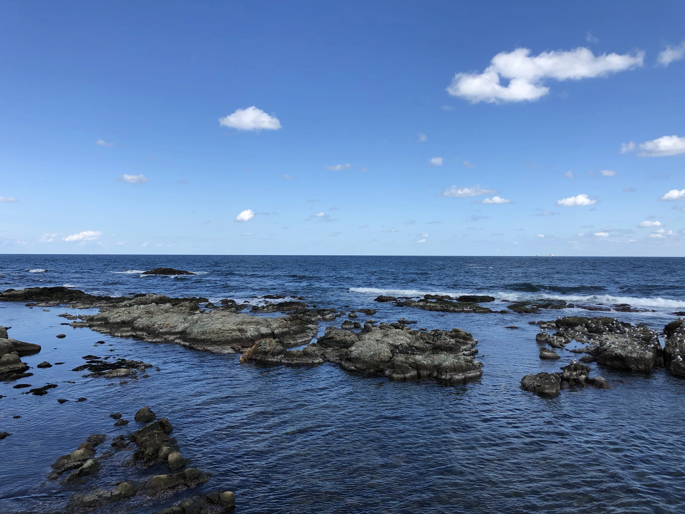
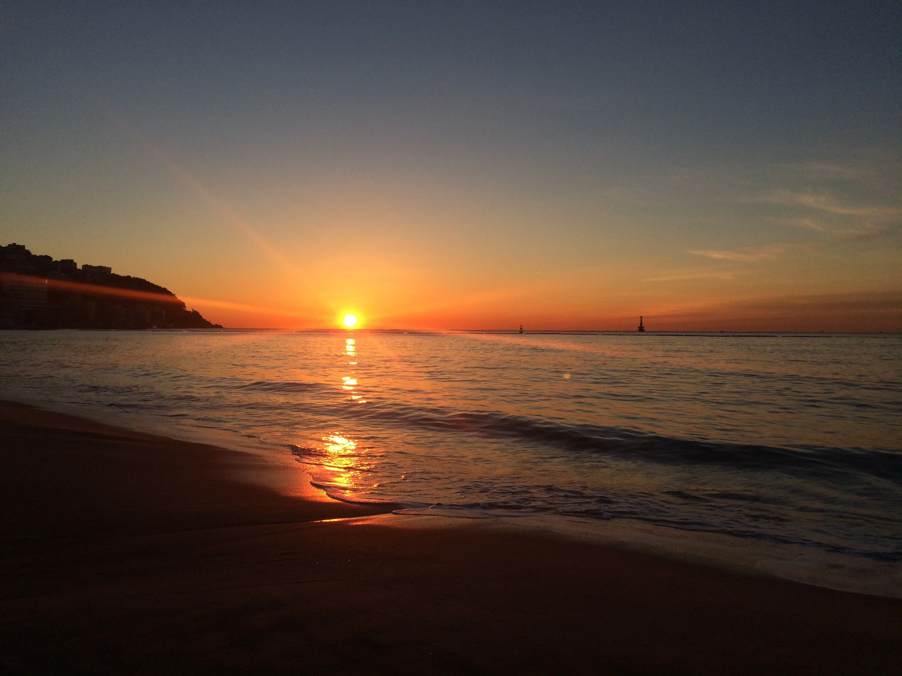
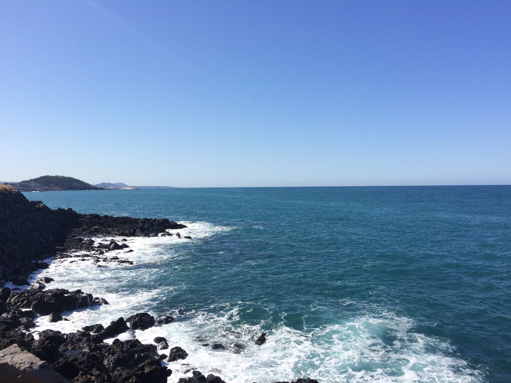
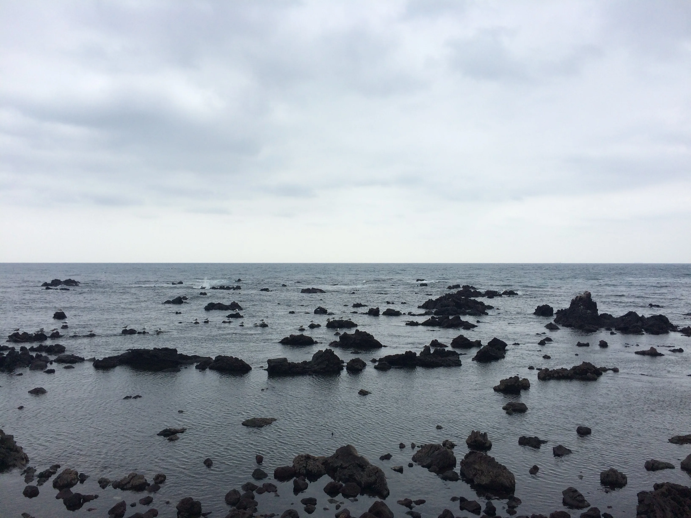
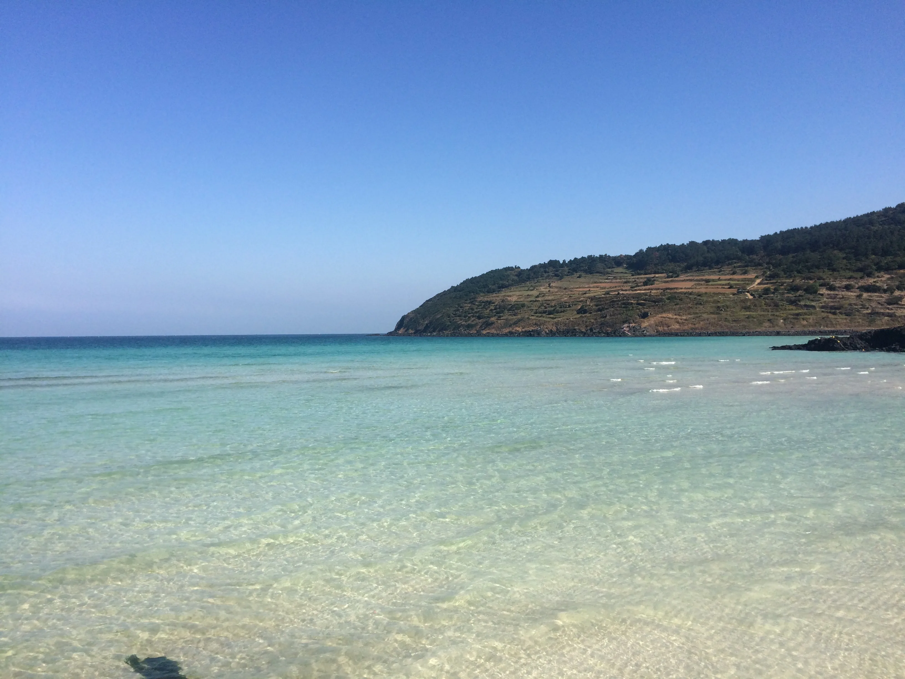
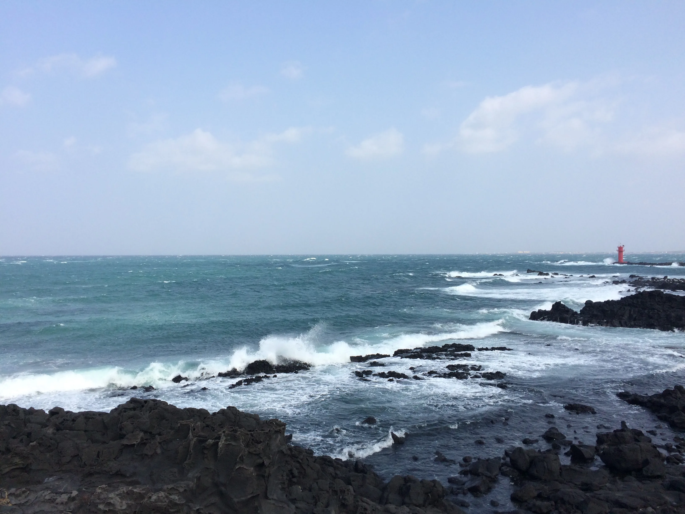

바다는 해변이나 해안 절벽, 바다 한 가운데라도 가리지 않고 좋아합니다. 호기심을 자극하는 바다의 광활함이 좋습니다. 계절과 날씨, 햇빛에 따라 다른 모습을 보여주는 점도 좋습니다. 바다가 익숙한 지역에서 나고 자랐기 때문인 것도 있겠죠. 여행을 가면 그 지역의 바다가 보이는 곳은 꼭 가보는 편입니다.

### 경상북도 포항시 남구 호미곶면 대보리

\
36° 4' 38.92" N, 129° 34' 13.338" E

### 부산광역시 해운대구

\
35° 9' 31.311" N, 129° 9' 37.383" E

### 제주특별자치도 제주시 용담동

\
33° 31' 5.334" N, 126° 29' 13.725" E

### 제주특별자치도 제주시 삼양동

\
33° 31' 38.447" N, 126° 35' 14.494" E

### 제주특별자치도 제주시 조천읍

\
33° 32' 38.335" N, 126° 40' 9.099" E

### 제주특별자치도 제주시 구좌읍
\
33° 31' 14.59" N, 126° 54' 14.271" E
